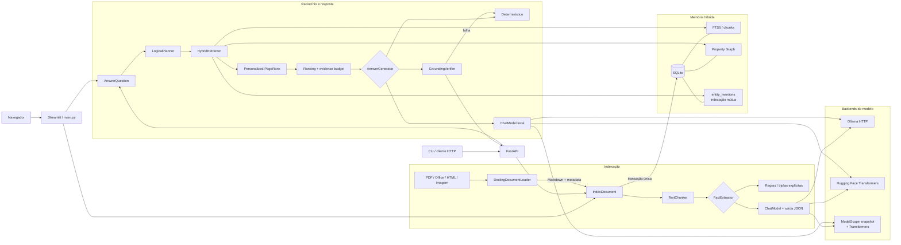
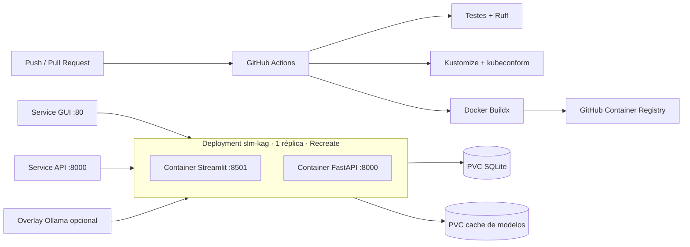
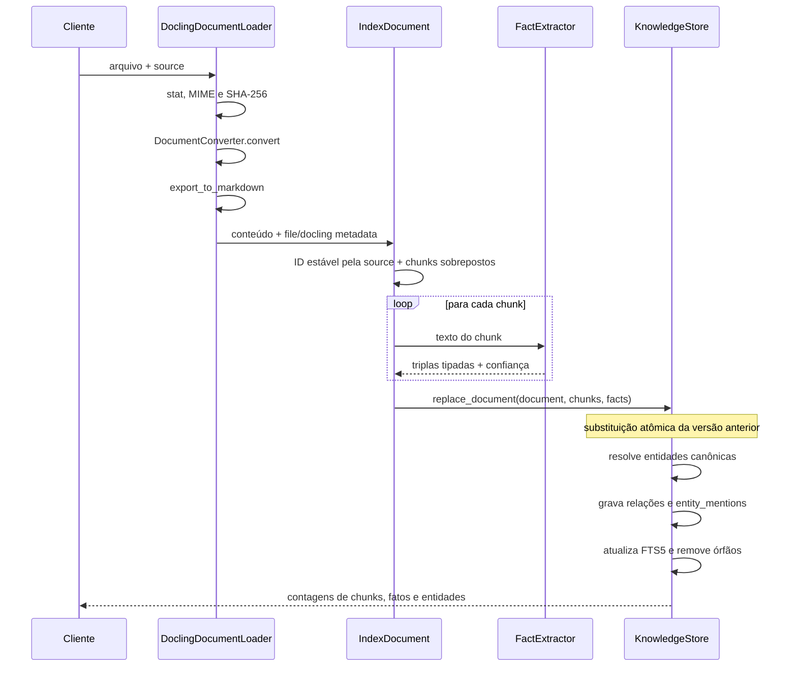
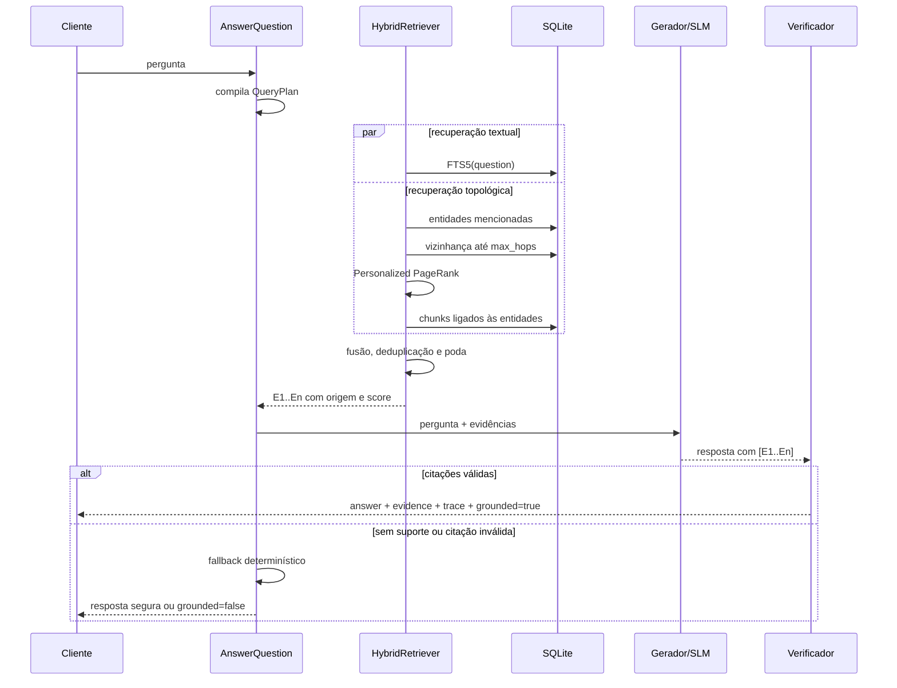
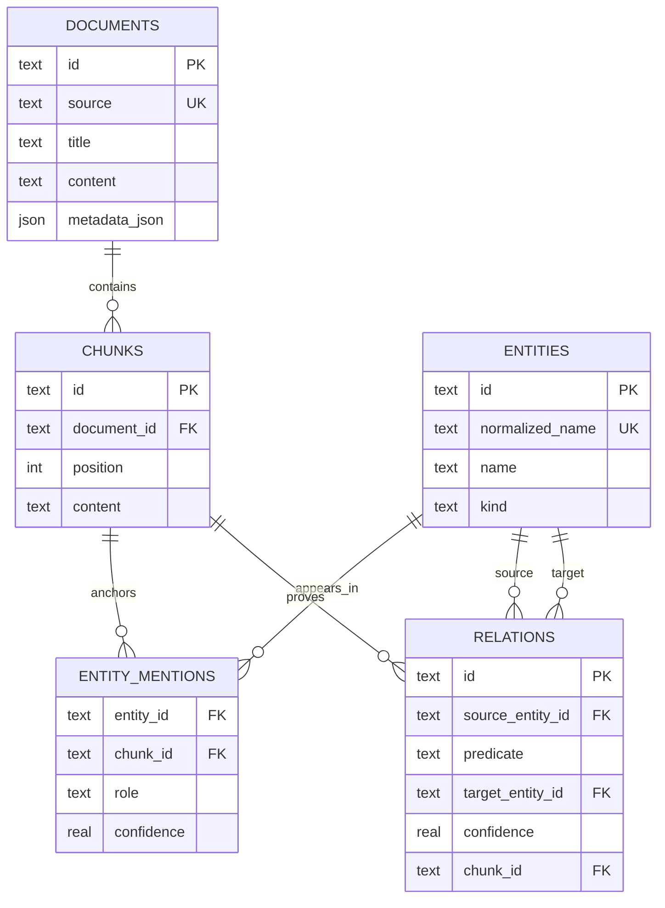

# Arquitetura do sistema SLM-KAG

## Objetivo

O sistema transforma documentos não estruturados em uma memória híbrida texto-grafo e entrega ao
SLM apenas um subgrafo pequeno, rastreável e relevante. A arquitetura adota o paradigma de
**pré-raciocínio simbólico/topológico** como caminho principal e permite o paradigma
**neuro-simbólico com ferramentas** pelos adaptadores de modelos locais. Isso reduz a carga de navegação e de
memória factual do modelo pequeno.

## Visão de contêineres e componentes



O núcleo depende de protocolos, não de FastAPI, SQLite, Ollama ou um hub específico. Isso permite trocar o banco por
Neo4j/OpenSPG/TuGraph e a busca textual por um índice vetorial sem alterar os casos de uso.

A GUI mantém somente configuração, uploads pendentes e histórico de conversa na sessão do
Streamlit. Documentos, chunks, grafo e metadados ficam no SQLite, portanto o usuário pode indexar
vários lotes antes de consultar e continuar acrescentando documentos depois. Cada upload recebe
uma origem estável derivada de SHA-256; reindexar o mesmo conteúdo/origem substitui sua versão em
vez de duplicá-la. Os binários temporários são apagados após a conversão pelo Docling.

## Implantação Kubernetes e entrega contínua



GUI e API permanecem no mesmo Pod para que os dois processos compartilhem o filesystem e o lock
do SQLite. A estratégia `Recreate` encerra a versão anterior antes do novo Pod durante upgrades.
Escalar horizontalmente exige primeiro substituir `KnowledgeStore` por um armazenamento de rede;
por isso o manifesto fixa uma réplica. Hugging Face, ModelScope e Docling reutilizam um PVC de
cache, enquanto o overlay Ollama provisiona serviço e volume próprios.

Pull requests executam qualidade, validação Kubernetes e build sem publicação. Pushes aceitos e
tags publicam a imagem completa no GHCR com SBOM, metadados por branch/tag/SHA e atestado de
proveniência. Credenciais de cluster não fazem parte do CI: aplicar a imagem é uma decisão separada
e explícita do operador.

## Abstração de modelos

`ChatModel` define apenas `chat(messages, format_schema)`. Extração e geração dependem desse
contrato e não sabem onde os pesos foram obtidos:

| Backend | Aquisição | Execução | Restrição estruturada |
|---|---|---|---|
| Ollama | catálogo do runtime | API HTTP local `/api/chat` | JSON Schema nativo |
| Hugging Face | `from_pretrained(model_id)` | Transformers/PyTorch | schema no prompt + parse JSON |
| ModelScope | `snapshot_download(model_id)` | Transformers/PyTorch | schema no prompt + parse JSON |

Os clientes Transformers são lazy: construir a API não baixa pesos nem reserva GPU. O primeiro
pedido que realmente precise do SLM carrega tokenizer e modelo sob lock. O cache é configurável e
`trust_remote_code=false` é o padrão para reduzir a superfície de execução de código de terceiros.

São recomendados modelos *Instruct* que publiquem seu próprio `chat_template`. Para modelos base
sem template, o adaptador possui uma serialização textual conservadora como fallback.

## Fluxo de indexação



O identificador do documento deriva de `source`, portanto uma nova ingestão da mesma origem
substitui a versão anterior. Relações, menções e chunks antigos são removidos por integridade
referencial; a atualização não deixa fatos obsoletos no grafo.

O arquivo é validado antes da conversão pelos limites de bytes e páginas. Uploads HTTP são gravados
em diretório temporário isolado e removidos ao fim da requisição. O banco retém o conteúdo
normalizado e os metadados, não o binário original.

## Fluxo de consulta



## Modelo de dados



`ENTITY_MENTIONS` é a implementação da indexação mútua: qualquer entidade retorna ao fragmento
original e toda relação carrega o `chunk_id` que a sustenta. A API nunca precisa apresentar uma
tripla sem proveniência documental.

## Correspondência entre requisitos SOTA e implementação

| Risco/requisito do estudo | Decisão arquitetural |
|---|---|
| Gargalo de extração | schema nativo no Ollama; instrução de schema + parse estrito nos hubs; regras como baseline |
| Entidades inventadas | filtro exige sujeito e objeto ancorados ao texto normalizado do chunk |
| Fragilidade multi-hop | travessia feita pelo sistema e não pelo SLM; `max_hops` limita propagação |
| Distração por ruído | PageRank, fusão por ranking, `top_k` e orçamento de evidências |
| Lost in the Middle | contexto pequeno, relações linearizadas e evidências numeradas |
| Auditabilidade | aresta→chunk→documento, scores, plano e contagens no `trace` |
| Proveniência documental | Docling `origin` + MIME, SHA-256, páginas, status e metadados do usuário |
| Privacidade | SQLite e Ollama locais; nenhuma chamada de nuvem no caminho padrão |
| Alucinação | resposta exige citações existentes; fallback seguro quando a validação falha |

## Limites conscientes e evolução

Esta primeira versão é uma vertical slice funcional, adequada a um nó e a corpora pequenos ou
médios. A evolução para produção deve preservar as portas em `ports.py` e trocar adaptadores:

1. **Escala de busca:** adicionar embeddings locais e Qdrant/pgvector; manter FTS para recuperação
   lexical e aplicar Reciprocal Rank Fusion.
2. **Escala do grafo:** implementar `KnowledgeStore` sobre OpenSPG, Neo4j ou TuGraph e executar PPR
   próximo aos dados.
3. **Esquema de domínio:** validar tipos e predicados contra uma ontologia versionada antes do
   commit, com fila de quarentena para fatos de baixa confiança.
4. **Raciocínio formal:** estender `QueryPlan` para filtros temporais, aritmética, agregações e regras
   de negócio executadas por operadores, nunca por texto livre.
5. **Qualidade:** adicionar golden sets de perguntas, métricas Recall@K, MRR, exact match, fidelidade
   de citações, latência p95 e taxa de fallback por modelo.
6. **Operação:** autenticação, limites de tamanho, logs estruturados sem conteúdo sensível,
   OpenTelemetry, snapshots e política de retenção.
7. **Destilação:** registrar planos e evidências verificadas como dataset offline para DRAG/KARD,
   mantendo treinamento fora do caminho de inferência.

## Estrutura do código

```text
src/slm_kag/
├── domain/models.py              # entidades, evidências, planos e respostas
├── ports.py                      # contratos de armazenamento, extração e geração
├── application/indexing.py       # chunking e caso de uso de ingestão
├── application/querying.py       # planner, PPR, fusão, verificação e resposta
├── infrastructure/sqlite_store.py# grafo, FTS5 e mutual indexing
├── infrastructure/document_loaders.py # Docling e metadados dos arquivos
├── infrastructure/extractors.py # regras e extração estruturada agnóstica
├── infrastructure/ollama.py      # cliente local e gerador fundamentado
├── infrastructure/transformers_client.py # Hugging Face e ModelScope
├── bootstrap.py                  # composição de dependências
├── api.py                        # adaptador HTTP
├── cli.py                        # adaptador de linha de comando
└── streamlit_app.py              # upload em lotes, configuração e chat fundamentado
main.py                           # ponto de entrada da GUI Streamlit
```
